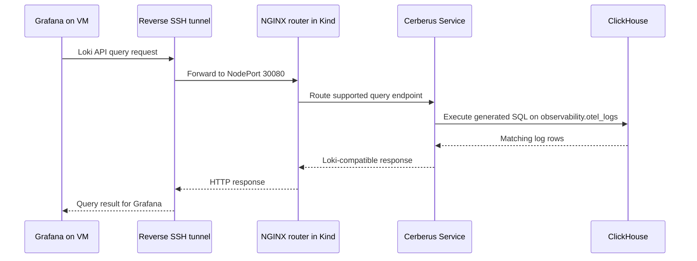

# Cerberus-Based Loki Query Routing to ClickHouse for Grafana Observability

## 1. Objective

The objective of this POC is to use Cerberus as a Loki-compatible query layer between Grafana and ClickHouse, allowing existing Grafana dashboards to query logs stored in ClickHouse without recreating dashboards from scratch. The POC also aims to preserve the existing Loki log-ingestion path while validating query compatibility.

### Intended Request Flow

1. **Grafana:** Sends log queries through the existing Loki data source at `http://127.0.0.1:32446`.
2. **Reverse SSH Tunnel:** Forwards requests from port `32446` on the Grafana VM to the Kubernetes NGINX router at `172.19.0.2:30080`.
3. **NGINX Router:** Routes supported Loki-compatible read and query requests to Cerberus, while log-push requests continue to Loki.
4. **Cerberus:** Translates supported Loki-compatible queries into ClickHouse queries.
5. **ClickHouse:** Executes queries against the `observability.otel_logs` table and returns matching log data.
6. **Grafana:** Displays the returned logs in Explore or dashboards, subject to query and dashboard compatibility.

**Query Request Flow:**

`Grafana → Reverse SSH Tunnel → NGINX Router → Cerberus → ClickHouse`

**Response Flow:**

`ClickHouse → Cerberus → NGINX Router → Reverse SSH Tunnel → Grafana`


## 2. POC Goals

-   Record the current logs, metrics, and traces pipelines.
-   Evaluate Cerberus as a Loki-compatible query layer for ClickHouse.
-   Aim to keep the existing Grafana Loki data source and dashboards
    unchanged, if technically feasible.
-   Preserve the current log-ingestion path while testing query routing.
-   Validate compatibility before changing any service or data-source
    endpoint.

## Table of Contents

- [1. Objective](#1-Objective)
- [2. POC Goals](#2-poc-goals)
- [3. Kubernetes Environment](#3-kubernetes-environment)
- [4. Architecture](#4-architecture)
- [5. Traditional Observability Stack](#5-traditional-observability-stack)
- [6. ClickHouse-Based Observability Pipeline](#6-clickhouse-based-observability-pipeline)
- [7. Grafana and Cerberus Query-Routing Goal](#7-grafana-and-cerberus-query-routing-goal)
  - [7.0. Cerberus explained: role, request flow, and POC boundaries](#70-cerberus-explained-role-request-flow-and-poc-boundaries)
  - [7.1–7.13. Cerberus setup and direct API validation](#71-cerberus-chart-and-schema-compatibility)
  - [7.14–7.21. Loki comparison, NGINX routing, and Grafana tunnel validation](#714-direct-loki-comparison----same-query-shape)
  - [7.22. Grafana Explore and ClickHouse SQL verification](#722-grafana-explore-and-clickhouse-sql-verification----2026-10-25)
  - [7.23. End-to-end routing evidence and correlation limits](#723-grafana--nginx--cerberus--clickhouse-validation----2026-10-25)
  - [7.24. Legacy `namespace` label compatibility issue and proposed fix](#724-legacy-namespace-label-compatibility-issue-and-proposed-fix)
- [8. Grafana Access and Reverse SSH Tunnel](#8-grafana-access-and-reverse-ssh-tunnel)
- [9. Storage and Separation Notes](#9-storage-and-separation-notes)
- [10. Open Questions and Next Steps](#10-open-questions-and-next-steps)
- [11. Current Status](#11-current-status)

---

## 3. Kubernetes Environment

Current context: `kind-kind-clickhouse-poc`.

  --------------------------------------------------------------------------
  Namespace                      Observed components   Role
  ------------------------------ --------------------- ---------------------
  `traditional-observability`    Loki, Tempo,          Traditional
                                 VictoriaMetrics,      observability stack
                                 vmagent, Fluent Bit,  
                                 OTel Collector        

  `logging`                      Fluent Bit DaemonSet  Container logs to
                                                       ClickHouse

  `monitoring`                   OTel Collector, OTel  Infrastructure
                                 logs Collector,       telemetry and OTel
                                 node-exporter,        log pipeline
                                 kube-state-metrics    

  `clickhouse`                   ClickHouse, Keeper,   ClickHouse telemetry
                                 services, PVCs        storage

  `gigapipe`                     Gigapipe pod and      Additional
                                 service               Loki-compatible log
                                                       destination

  `hyperdx`                      HyperDX, MongoDB,     Separate HyperDX POC
                                 HyperDX OTel          
                                 Collector             

  `clickhouse-operator-system`   ClickHouse Operator   ClickHouse cluster
                                                       management
  --------------------------------------------------------------------------

## 4. Architecture


Solid arrows represent paths supported by the inspected configurations.
Dashed arrows are not proof of a working Cerberus deployment.
VictoriaMetrics is deployed, but its complete ingestion path has not yet
been verified.

## 5. Traditional Observability Stack

Namespace: `traditional-observability`.

Components observed: - Loki StatefulSet and services: `loki-stack`,
`loki-external`. - Tempo StatefulSet and service. - VictoriaMetrics
single-server StatefulSet and service. - vmagent Deployment. -
`fluent-bit-traditional` DaemonSet. -
`otel-collector-traditional-opentelemetry-collector` Deployment. - Loki
storage exporter Deployment.

### 5.1 Fluent Bit → Loki and Gigapipe

ConfigMap: `fluent-bit-traditional`.

The configuration tails `/var/log/containers/*.log`, excludes Fluent
Bit's own logs, applies Docker/CRI multiline parsing, and adds
Kubernetes metadata.

Two outputs are configured for matching records:

1.  Loki: `loki-stack.traditional-observability.svc.cluster.local:3100`.
2.  Gigapipe: `gigapipe.gigapipe.svc.cluster.local:3100`.

Both use Fluent Bit's `loki` output plugin and labels for job,
namespace, pod, and container. The inspected configuration sends
matching container logs to both destinations.

### 5.2 Traditional OpenTelemetry Collector

ConfigMap: `otel-collector-traditional-opentelemetry-collector`.

Receivers include OTLP gRPC `4317`, OTLP HTTP `4318`, Jaeger, Zipkin,
and a Prometheus receiver scraping the collector's own metrics endpoint
on port `8888`.

Inspected pipelines: - **Logs:** OTLP receiver → memory limiter → batch
→ `debug` exporter. - **Metrics:** OTLP and Prometheus receivers →
memory limiter → batch → `debug` exporter. - **Traces:** OTLP receiver →
batch → OTLP/gRPC exporter to
`tempo.traditional-observability.svc.cluster.local:4317` (TLS insecure
enabled).

Based on this ConfigMap, this collector's logs and metrics pipelines do
not directly export to Loki or VictoriaMetrics. Its traces pipeline
exports to Tempo. Other independent telemetry paths may exist.

### 5.3 Services and PVCs observed

  --------------------------------------------------------------------------------
  Service                                             Observed endpoint
  --------------------------------------------------- ----------------------------
  `loki-stack`                                        ClusterIP, port `3100`

  `loki-external`                                     NodePort `32446`, service
                                                      port `3100`, target port
                                                      `3100`

  `tempo`                                             ClusterIP; includes OTLP
                                                      gRPC port `4317`

  `tempo-external`                                    NodePort `31000`, service
                                                      port `3200`

  `victoria-metrics-victoria-metrics-single-server`   ClusterIP, port `8428`

  `vm-external`                                       NodePort `31720`, service
                                                      port `8428`
  --------------------------------------------------------------------------------

PVCs observed: Loki `5Gi`, Tempo `5Gi`, VictoriaMetrics `16Gi`.

The `loki-external` Service selects Loki pods directly (`app=loki`,

### 5.4 Loki Service endpoint verification

The Service was inspected with:

``` bash
kubectl get svc loki-external -n traditional-observability -o wide
```

Observed output:

``` text
NAME            TYPE       CLUSTER-IP      EXTERNAL-IP   PORT(S)          AGE   SELECTOR
loki-external   NodePort   10.96.114.231   <none>        3100:32446/TCP   22d   app=loki,release=loki-stack
```

The endpoints were checked with:

``` bash
kubectl get endpoints loki-external -n traditional-observability -o wide
```

Observed endpoint: `10.244.2.8:3100`.

The matching pod was checked with:

``` bash
kubectl get pods -n traditional-observability -l app=loki,release=loki-stack -o wide
```

Observed pod details: `loki-stack-0`, `1/1` Ready, status `Running`, pod
IP `10.244.2.8`, node `kind-clickhouse-poc-worker`, and 31 restarts (the
latest restart was shown as approximately 6 hours 47 minutes before the
check).

This confirms that `loki-external` currently routes to `loki-stack-0` at
`10.244.2.8:3100`. The restart count is worth investigating later but
does not alone establish a current outage.

`release=loki-stack`). It does not currently route traffic through
Cerberus.

## 6. ClickHouse-Based Observability Pipeline

Namespace: `clickhouse`.

Observed components: - ClickHouse pod: `clickhouse-clickhouse-0-0-0`. -
Keeper pod: `clickhouse-keeper-keeper-0-0`. - ClickHouse Operator in
`clickhouse-operator-system`. - ClickHouse PVC `5Gi`; Keeper PVC
`2Gi`. - ClickHouse version previously observed: `26.9.4.3`.

Services observed: - `clickhouse-clickhouse-headless`: ports `8123`,
`9363`, `9000`. - `clickhouse-clickhouse-internal-0-0`: ports `9009`,
`9001`, `9002`. - `clickhouse-http`: NodePort `30081` → service port
`8123`. - Keeper headless service: ports `9234`, `9090`, `2181`.

The pipelines use the `observability` database.

### 6.1 Fluent Bit → `observability.kubernetes_logs`

ConfigMap: `fluent-bit` in namespace `logging`.

Output configuration: - Host:
`clickhouse-clickhouse-headless.clickhouse.svc.cluster.local` - Port:
`8123` (HTTP) - Target: `observability.kubernetes_logs` - Format:
`JSONEachRow`

Inspected table columns include `timestamp DateTime`,
`namespace String`, `pod String`, `container String`, `node String`, and
`message String`.

### 6.2 OTel file logs → `observability.otel_logs`

ConfigMap: `otel-logs-opentelemetry-collector-agent` in namespace
`monitoring`.

The `file_log` receiver reads `/var/log/pods/*/*/*.log`, excludes the
collector's own log path, uses a container parser, and has
`start_at: end`.

ClickHouse exporter settings: - Endpoint:
`tcp://clickhouse-clickhouse-headless.clickhouse.svc.cluster.local:9000` -
Database: `observability` - Logs table: `otel_logs` -
`async_insert: true` - `create_schema: true` - Username: `default`

The logs pipeline sends `file_log` records through memory limiter and
batch processors to ClickHouse. The inspected `otel_logs` schema
includes OpenTelemetry-style fields such as `Timestamp`, `Body`,
`SeverityText`, `ServiceName`, and `ResourceAttributes`.

The metrics and traces pipelines in this particular logs-agent ConfigMap
use `debug`, not the ClickHouse exporter.

### 6.3 OTel metrics and traces → ClickHouse

ConfigMap: `otel-collector-opentelemetry-collector` in namespace
`monitoring`.

Receivers include OTLP, Jaeger, Zipkin, and Prometheus scrape jobs for
infrastructure components such as node-exporter, kube-state-metrics, and
cAdvisor through the configured API path.

ClickHouse exporter settings include endpoint
`tcp://clickhouse-clickhouse-headless.clickhouse.svc.cluster.local:9000`,
database `observability`, `async_insert: true`, `create_schema: true`,
and username `default`.

Inspected pipelines: - **Metrics:** Prometheus receiver → ClickHouse
exporter. - **Traces:** OTLP traces → ClickHouse exporter; Jaeger and
Zipkin receivers are also configured. - **Logs:** OTLP receiver →
`debug` exporter.

Live queries should verify which receivers are actively delivering data
and how records are distributed among tables.

### 6.4 Tables observed

Tables listed in `observability` include:

-   `kubernetes_logs`
-   `kubernetes_logs_real_test`
-   `kubernetes_logs_test`
-   `logs`
-   `metrics`
-   `otel_logs`
-   `otel_metrics_exponential_histogram`
-   `otel_metrics_gauge`
-   `otel_metrics_histogram`
-   `otel_metrics_sum`
-   `otel_metrics_summary`
-   `otel_traces`
-   `otel_traces_trace_id_ts`
-   `otel_traces_trace_id_ts_mv`

A previous POC query observed approximately 2.66 million rows in
`observability.otel_logs`. This is a historical observation, not a
guaranteed current count.

### 6.5 Recent data validation

The latest rows were checked using:

``` sql
SELECT
    timestamp,
    namespace,
    pod,
    container,
    node,
    message
FROM observability.kubernetes_logs
ORDER BY timestamp DESC
LIMIT 5
FORMAT Vertical;
```

The query returned five rows with timestamps of `2026-10-23 11:36:17`.
The rows included logs from the `gigapipe` namespace,
`traditional-observability` (including `loki-storage-exporter` and
`loki-stack-0`), and `hyperdx`. The `loki-stack-0` sample contained a
Loki query log with `status=200`; the exporter sample showed a
successful `/metrics` request with HTTP `200`.

Two of the five returned `gigapipe` rows had empty `message` values.
This is an observation from the sample and should be investigated only
if it affects the intended query results; it does not by itself
establish a table-ingestion failure.

This confirms that `observability.kubernetes_logs` contains recent
timestamped records and that the selected columns can be queried. It
does not yet prove full data parity with Loki or compatibility with
Cerberus LogQL translation.

## 7. Grafana and Cerberus Query-Routing Goal

Grafana runs on a separate VM. The existing Loki data source URL is
`http://127.0.0.1:32446`; a separate Cerberus test tunnel is available
at `http://127.0.0.1:18081`. The existing data source has not been
changed.

The target of the evaluation is to determine whether Grafana's existing
Loki data source and dashboards can remain unchanged while a
Loki-compatible query gateway sends supported queries to ClickHouse
through Cerberus.

### Important routing constraint

The current `loki-external` NodePort `32446` forwards directly to Loki.
Fluent Bit also sends logs to Loki through the internal `loki-stack`
Service. Replacing that Service's selector with Cerberus without a
deliberate routing design could break existing traffic and ingestion.

Cerberus is being evaluated as a **query layer**, not a log-ingestion
destination. The final design must preserve write/ingestion paths and
route only suitable query requests through Cerberus. HTTP paths,
methods, supported LogQL features, and table-schema compatibility must
be tested first.

Cerberus is installed in a separate namespace and tested directly. No
Loki Service selector change or reverse-proxy configuration has been
performed. The existing Grafana Loki data source has not been modified;
Cerberus is being exposed through a separate test tunnel.

### 7.0 Cerberus explained: role, request flow, and POC boundaries

#### What is Cerberus?

Cerberus is a stateless, read-only query gateway for ClickHouse. It exposes HTTP API endpoints compatible with observability tools such as Grafana's Prometheus, Loki, and Tempo data sources, and translates supported query-language requests into ClickHouse SQL. The upstream project describes support for PromQL, LogQL, and TraceQL; this POC is deliberately focused on **logs and Loki-compatible queries only**. Metrics and traces are out of scope for the current Gigapipe/Cerberus evaluation, and the existing VictoriaMetrics and Tempo paths should remain unchanged.

In simple terms, Grafana sends a Loki-style HTTP request to Cerberus. Cerberus parses the LogQL query, maps its meaning to the configured OpenTelemetry ClickHouse schema, builds and executes SQL against ClickHouse, then formats the returned records into a Loki-compatible HTTP response. Grafana can therefore continue speaking the Loki API for query operations without Cerberus itself being a Loki server or a log database.

#### What Cerberus does—and does not do

| Cerberus does | Cerberus does not |
| --- | --- |
| Accept supported Loki-compatible query API requests. | Store logs or act as the durable database. |
| Translate supported LogQL/query operations into ClickHouse SQL. | Ingest logs from Fluent Bit or replace the OpenTelemetry Collector. |
| Read the configured ClickHouse tables and return a Loki-shaped response. | Automatically guarantee complete LogQL feature parity or identical results for every dashboard. |
| Provide a query endpoint that can sit behind a reverse proxy/router. | Automatically redirect Grafana traffic; the datasource URL or network routing must reach it. |
| Allow a gradual compatibility POC before considering a datasource cutover. | Make the existing Loki write/push path safe to change without separate routing validation. |

Cerberus is intended to be on the **read/query side**. Writers should continue writing to their current destinations—ClickHouse, Loki, or both as configured—rather than sending ingestion traffic to Cerberus.

#### Request flow in this POC



The sequence above describes the intended and partially validated query route. The README's later validation sections record which links have been tested. It should not be interpreted as proof that every Grafana panel or every Loki API endpoint works end to end.

The current POC routing design is:

1. Grafana's existing Loki datasource uses `http://127.0.0.1:32446` on the Grafana VM.
2. The reverse SSH tunnel forwards that local port to the Kind node's NGINX NodePort, `172.19.0.2:30080`.
3. NGINX sends selected Loki **query/read** API paths to Cerberus; the `/loki/api/v1/push` write path is configured to continue to Loki.
4. Cerberus connects to ClickHouse using the native protocol at `clickhouse-clickhouse-headless.clickhouse.svc.cluster.local:9000` and queries database `observability`, table `otel_logs`.
5. Cerberus returns a Loki-compatible response to the caller.

Because NGINX is doing path-based routing, not every request to the existing datasource endpoint necessarily goes to Cerberus. Query paths selected by the NGINX rules are routed to Cerberus; push and fallback paths remain routed to Loki according to the current configuration. Review Section 7.23 for the evidence and its limits.

#### Why the OpenTelemetry table schema matters

Cerberus does not magically understand any arbitrary ClickHouse table. It needs the columns and data layout expected by its configured schema. The preferred table in this POC is `observability.otel_logs`, which has OpenTelemetry-style columns such as `Timestamp`, `Body`, `ResourceAttributes`, and `LogAttributes`, along with materialized Kubernetes metadata. This is a closer match than `observability.kubernetes_logs`, whose simpler columns are `timestamp`, `namespace`, `pod`, `container`, `node`, and `message`.

For this deployment, the relevant configuration includes:

| Setting | Current POC value | Purpose |
| --- | --- | --- |
| `CERBERUS_CH_ADDR` | `clickhouse-clickhouse-headless.clickhouse.svc.cluster.local:9000` | ClickHouse native-protocol endpoint. |
| `CERBERUS_CH_DATABASE` | `observability` | Database containing the telemetry tables. |
| `CERBERUS_CH_PROTOCOL` | `native` | Use ClickHouse's native protocol. |
| `CERBERUS_SCHEMA_LOGS_TABLE` | `otel_logs` | Tell Cerberus which logs table to query. |
| `CERBERUS_ADMIT_LOKI` | `true` | Enable Cerberus's Loki request admission control. |
| `CERBERUS_LOG_LEVEL` | `info` | Application log verbosity. |
| `CERBERUS_LOG_FORMAT` | `json` | Structured JSON application logs. |

These are the values recorded for the current POC, not a universal production configuration. Credentials, if configured, should be supplied securely through Kubernetes Secrets rather than committed to a README or values file.

#### What happens when a query arrives?

1. **HTTP/API routing:** Cerberus receives a Loki-compatible request such as `/loki/api/v1/query_range`.
2. **Query parsing:** it parses the supported LogQL expression and the query time range/step parameters.
3. **SQL generation:** it maps the expression to the configured ClickHouse schema and generates SQL. For example, a Kubernetes namespace selector can become a predicate on a materialized namespace column.
4. **Execution:** ClickHouse scans or filters the relevant data and returns rows or aggregates.
5. **Response conversion:** Cerberus shapes the results into the response format expected by a Loki-compatible client such as Grafana.
6. **Panel rendering:** Grafana renders the response. A successful HTTP response alone is not enough to prove the displayed result is semantically identical to Loki; results and labels must also be compared.

#### Benefits and trade-offs

**Potential benefits**

- Reuse supported Loki query expressions and existing Grafana panels rather than rebuilding everything as ClickHouse SQL.
- Keep query access separate from the log-ingestion path.
- Use ClickHouse as the storage/query engine for logs already written in a compatible OpenTelemetry schema.
- Test routing and query compatibility incrementally through a reverse proxy before changing the production datasource configuration.

**Important limitations and risks**

- Compatibility is query-by-query and endpoint-by-endpoint; do not assume all LogQL functions, label lookups, tailing, detected-fields endpoints, or dashboard transformations are supported identically.
- The table schema, timestamp types, labels/attributes, and field population affect query correctness. In this dataset, `ServiceName` was observed to be empty, so service-name-based filtering may be unhelpful.
- Query latency and result parity must be compared using equivalent queries, time ranges, and result limits. A successful response is not itself proof of full parity.
- The gateway adds another service and routing hop to debug and secure. Apply network restrictions and least-privilege ClickHouse access, and monitor errors and query resource usage.
- This POC does not establish production readiness, high availability, full Grafana dashboard compatibility, or a complete replacement for Loki.

#### How to validate Cerberus safely

- Confirm the Cerberus pod and Service are healthy and can reach ClickHouse.
- Run a direct Cerberus API query for a known namespace and time window.
- Confirm the matching SQL appears in ClickHouse `system.query_log` and that the query reads `observability.otel_logs`.
- Compare the same selector and time window against Loki, checking log lines, timestamps, labels, and counts—not only HTTP status.
- Verify Grafana Explore and representative existing dashboard panels through the NGINX/tunnel route.
- Test ingestion separately. Keep `/loki/api/v1/push` routed to Loki unless a deliberately designed and validated write path says otherwise.
- Only consider a datasource or routing cutover after documenting the supported query surface, known differences, rollback path, and dashboard-by-dashboard results.

Official project reference: [tsouza/cerberus on GitHub](https://github.com/tsouza/cerberus). The capabilities described by the upstream project are broader than this POC; the live configuration and evidence in the following sections determine what has actually been tested here.

### 7.1 Cerberus chart and schema compatibility

The Cerberus Helm chart values were inspected using:

``` bash
helm show values oci://ghcr.io/tsouza/cerberus/charts/cerberus --version 0.18.0
```

Chart defaults and available configuration show: - The default
deployment mode is `monolith`; the default replica count is `2`. - The
default ClickHouse protocol is `native`, with port `9000` in the example
address. - The service defaults to `ClusterIP` on port `8080`. - The
chart's `config` map can set additional `CERBERUS_*` environment
variables. - The intended POC connection is to
`clickhouse-clickhouse-headless.clickhouse.svc.cluster.local:9000`,
database `observability`, with automatic schema/database creation
disabled.

**Schema compatibility finding:** Cerberus reads the OpenTelemetry
ClickHouse Exporter schema by default. Its documented
`CERBERUS_SCHEMA_LOGS_TABLE` setting changes the logs table name, but
the current configuration surface does not provide column-name
overrides. The existing `observability.kubernetes_logs` table has only
`timestamp`, `namespace`, `pod`, `container`, `node`, and `message`; it
does not have expected OTel columns such as `Timestamp`, `Body`,
`ResourceAttributes`, and `LogAttributes`.

Therefore, simply setting `CERBERUS_SCHEMA_LOGS_TABLE=kubernetes_logs`
is not considered compatible without further schema adaptation.

**Updated table choice:** after inspecting both tables, the POC will
evaluate `observability.otel_logs` first because it already has the
standard OTel-style columns expected by Cerberus. This avoids building a
compatibility view over `kubernetes_logs` unless later testing shows a
need for it. The initial data checks are promising, but they do not
prove that Cerberus can query the table successfully or that all
required labels and LogQL behavior work.

No compatibility view has been created and no ClickHouse DDL was applied
as part of the initial schema checks. Cerberus was subsequently
installed and its Loki-compatible API was tested; see Sections
7.11--7.16.

### 7.2 `otel_logs` schema and live-data validation

The following command was used to inspect the table schema:

``` bash
kubectl exec -n clickhouse clickhouse-clickhouse-0-0-0 -- \
  clickhouse-client --query "DESCRIBE TABLE observability.otel_logs"
```

The inspected schema includes `Timestamp DateTime64(9)`, `TraceId`,
`SpanId`, `TraceFlags`, `SeverityText`, `SeverityNumber`, `ServiceName`,
`Body`, `ResourceAttributes`, `ScopeAttributes`, `LogAttributes`, and
OTel materialized Kubernetes metadata columns. This is structurally
closer to the schema Cerberus expects than `kubernetes_logs`.

A read-only data summary query returned:

  Check                                               Observed result
  --------------------------------- ---------------------------------
  Latest `Timestamp`                  `2026-10-23 11:47:21.278312092`
  Total rows                                              `2,744,925`
  Rows in the previous 15 minutes                            `10,236`
  Rows with non-empty `Body`                              `2,715,447`
  `uniqExact(ServiceName)`                                        `1`

The non-empty `Body` ratio in this snapshot was approximately 98.9%.
`uniqExact(ServiceName) = 1` alone does not demonstrate service-name
diversity; in the subsequent sample rows, `ServiceName` was empty, so
the actual service-name population should be investigated before
treating it as a useful filter/label.

A query of the five newest records showed recent container logs and
populated Kubernetes resource attributes:

-   `traditional-observability/loki-storage-exporter-54d7566fd8-mrhj8`,
    container `exporter`, with an HTTP `GET /metrics` status `200`
    message.
-   `traditional-observability/loki-stack-0`, container `loki`, with a
    Loki query log.
-   `logging` namespace Fluent Bit pods, with ClickHouse exporter HTTP
    status `200` messages.

The sample's `LogAttributes` keys were `log.file.path`, `log.iostream`,
and `logtag`. These checks establish that recent messages and Kubernetes
metadata are present in `otel_logs`; they do not yet prove Cerberus
readiness, complete LogQL compatibility, or parity with Loki. All checks
were read-only and used `otel_logs` only for inspection; no table was
modified.

### 7.3 `otel_logs` service-name validation

A live aggregation query was run against `observability.otel_logs`:

``` sql
SELECT
    if(empty(ServiceName), '(empty)', ServiceName) AS service_name,
    count() AS rows
FROM observability.otel_logs
GROUP BY service_name
ORDER BY rows DESC
LIMIT 10;
```

Observed result on 2026-10-23:

``` text
(empty)  2746568
```

All 2,746,568 rows present at the time of this query had an empty
`ServiceName`. This is a confirmed property of the current stored data,
not just the five-row sample inspected earlier. Kubernetes namespace,
pod, and container metadata were present in `ResourceAttributes` in the
sampled recent rows, while `LogAttributes` contained keys such as
`log.file.path`, `log.iostream`, and `logtag`.

**Implication for Cerberus:** `otel_logs` remains the preferred initial
table candidate because its column schema matches the OpenTelemetry
layout Cerberus expects more closely than `kubernetes_logs`. However,
service-name-based filtering or grouping may be limited until
`ServiceName` is populated. This finding alone does not prove Cerberus
will fail; next, test Cerberus with the existing table schema and
representative Loki-compatible queries before changing ingestion or
Grafana routing.

No ClickHouse schema, OTel Collector configuration, Loki service, or
Grafana datasource was changed during this validation.

### 7.4 Cerberus render and ClickHouse authentication pre-checks

The Cerberus Helm chart was rendered locally without installing it:

``` bash
helm template cerberus \
  oci://ghcr.io/tsouza/cerberus/charts/cerberus \
  --version 0.18.0 \
  --namespace clickhouse \
  --set replicaCount=1 \
  --set 'clickhouse.addr[0]=clickhouse-clickhouse-headless.clickhouse.svc.cluster.local:9000' \
  --set clickhouse.database=observability \
  --set clickhouse.username=default \
  --set clickhouse.protocol=native \
  --set autoCreate.schema=false \
  --set autoCreate.database=false \
  --set-string config.CERBERUS_SCHEMA_LOGS_TABLE=otel_logs \
  > ~/helm/cerberus.render.yml
```

The render completed successfully. The rendered file is located at
`/home/surajtripathi/helm/cerberus.render.yml` (approximately 4.9 KB at
the time of the check). A `grep` inspection confirmed these values in
the rendered manifest:

``` text
CERBERUS_CH_ADDR: clickhouse-clickhouse-headless.clickhouse.svc.cluster.local:9000
CERBERUS_CH_DATABASE: observability
CERBERUS_SCHEMA_LOGS_TABLE: otel_logs
containerPort: 8080
```

This was a Helm template render only; it did not create Kubernetes
resources.

The ClickHouse `default` user was inspected using `system.users`.
Observed authentication metadata:

``` text
name: default
auth_type: ['no_password']
host_ip: ['::/0']
host_names: []
host_names_regexp: []
host_names_like: []
```

This confirms that the observed `default` user is configured for
passwordless authentication and has the shown host restriction in
ClickHouse metadata. It does not yet prove that a Cerberus pod can
connect successfully over the Kubernetes network. A read-only service
and endpoint check for `clickhouse-clickhouse-headless` remains the next
pre-deployment validation.

No Cerberus release has been installed. The existing Loki service,
Grafana data source, reverse SSH tunnel, ClickHouse tables, and OTel
Collector configuration remain unchanged.

### 7.5 In-cluster ClickHouse connectivity test

After checking the headless Service and its endpoints, an ephemeral pod
was used to test the same DNS name and native port planned for Cerberus:

``` bash
kubectl run ch-connectivity-test \
  -n clickhouse \
  --rm -i \
  --restart=Never \
  --image=clickhouse/clickhouse-server:26.9.4.3 \
  -- clickhouse-client \
     --host clickhouse-clickhouse-headless.clickhouse.svc.cluster.local \
     --port 9000 \
     --user default \
     --query "SELECT version(), 1"
```

Observed output:

``` text
26.9.4.3    1
pod "ch-connectivity-test" deleted
```

**Result:** in-cluster DNS resolution, TCP/native-protocol connectivity,
and a basic query using the `default` user succeeded from the temporary
test pod. The test pod was removed by `kubectl run --rm`. This confirms
the ClickHouse connection path from a pod; it does not yet validate
Cerberus-specific schema compatibility or LogQL query behavior.

No existing Loki service, Grafana datasource, ingestion configuration,
or ClickHouse table was changed by this test.

### 7.6 Dedicated Cerberus namespace

A dedicated namespace was created for Cerberus to keep its Deployment,
Service, and related resources separate from ClickHouse and Keeper:

``` bash
kubectl create namespace cerberus
kubectl get namespace cerberus
```

Observed output confirmed `namespace/cerberus` was created and its
status was `Active`. The namespace is currently empty unless later
deployment steps add resources. This is an isolation and
resource-organization choice; it does not prevent Cerberus from
connecting to ClickHouse in the `clickhouse` namespace. The intended
ClickHouse DNS name remains
`clickhouse-clickhouse-headless.clickhouse.svc.cluster.local:9000`.

No Cerberus Helm release has been installed yet, and no Loki or Grafana
routing has been changed.

### 7.7 Cerberus Helm installation

Cerberus chart version `0.18.0` was installed in the dedicated
`cerberus` namespace using a single replica. Helm reported:

``` text
Release "cerberus" does not exist. Installing it now.
Pulled: ghcr.io/tsouza/cerberus/charts/cerberus:0.18.0
NAME: cerberus
NAMESPACE: cerberus
STATUS: deployed
REVISION: 1
DESCRIPTION: Install complete
```

Configured ClickHouse target reported by Helm:

``` text
Address: clickhouse-clickhouse-headless.clickhouse.svc.cluster.local:9000
Database: observability
Logs table override: otel_logs
Auto-create schema/database: false
```

Helm notes show the Cerberus Service is intended to be reached
in-cluster at `cerberus.cerberus.svc:8080`; readiness is exposed at
`/readyz`, and liveness at `/healthz`. Self-telemetry export is
currently disabled because the OTLP endpoint is empty.

**Important:** Helm's `STATUS: deployed` confirms the release was
installed, not that the pod is Ready or that Cerberus can successfully
query `observability.otel_logs`. Those checks are still pending. Do not
change the Grafana Loki data source or existing Loki Service while
validating the new gateway.

### 7.8 Cerberus pod and Service status

After the Helm installation, the following command was run:

``` bash
kubectl get pods,svc -n cerberus -o wide
```

Observed result:

``` text
pod/cerberus-5b655db4fb-g2fkz   1/1   Running   0   92s   10.244.1.15   kind-clickhouse-poc-worker2
service/cerberus                ClusterIP   10.96.165.8   <none>   8080/TCP
```

**Result:** the Cerberus pod is `1/1 Running`, has zero restarts at the
time of the check, and the ClusterIP Service is present on port `8080`.
The next validation is the `/readyz` endpoint, which checks ClickHouse
connectivity. A Running pod alone does not establish readiness or prove
Loki-compatible query behavior.

No Grafana data source, Loki Service, or log-ingestion configuration has
been changed.

### 7.9 Cerberus readiness endpoint

The local port `8080` was already occupied, so the Service was
port-forwarded to local port `8081` instead:

``` bash
kubectl port-forward -n cerberus svc/cerberus 8081:8080
curl -i http://127.0.0.1:8081/readyz
```

Observed response:

``` http
HTTP/1.1 200 OK
Content-Type: application/json

{"clickhouse":"ok","schema":"ready","heads":{"loki":"closed","prom":"closed","tempo":"closed"}}
```

**Result:** Cerberus readiness returned HTTP `200`; its ClickHouse check
is `ok` and schema status is `ready`. At this point, the Loki,
Prometheus, and Tempo heads report `closed`. This is a successful
readiness check, but it does not by itself prove that the
Loki-compatible API can query the existing `otel_logs` table. Since this
POC is evaluating logs only, the next phase must validate Cerberus's
Loki-compatible endpoints and actual log-query behavior without
redirecting Grafana or changing Loki ingestion.

### 7.10 Cerberus startup logs

The Deployment logs were checked after the readiness endpoint returned
HTTP `200`:

``` bash
kubectl logs -n cerberus deployment/cerberus --tail=100
```

The visible startup messages report: - Cerberus version `1.22.0`, HTTP
listener `:8080`, and ClickHouse database `observability`. - ClickHouse
server version `26.9.4.3` and a passed requirements check
(`native_rate: true`). - Admission control enabled for Prometheus, Loki,
and Tempo. - `query heads enabled` with `prom,loki,tempo`. -
`HTTP listener ready`.

No errors appear in the supplied startup-log excerpt. The readiness
payload previously reported each head as `closed`, so the next check is
to call the Loki-compatible HTTP API directly and inspect its response.
The log excerpt alone does not establish successful log queries against
`otel_logs`.

### 7.11 Cerberus Loki labels API validation

The Loki-compatible labels endpoint was tested through the local
port-forward on port `8081`:

``` bash
curl -i http://127.0.0.1:8081/loki/api/v1/labels
```

Observed response:

``` http
HTTP/1.1 200 OK
Content-Type: application/json

{"status":"success","data":["k8s_container_name","k8s_container_restart_count","k8s_namespace_name","k8s_pod_name","k8s_pod_uid"]}
```

**Result:** Cerberus's Loki labels endpoint returns HTTP `200` and lists
Kubernetes-related labels. This is the first successful direct Loki API
check. The next step is to query a known namespace (for example,
`traditional-observability`) over a recent time range and verify that
returned log entries match records in ClickHouse. A successful labels
response alone does not establish log-query compatibility or complete
parity with Loki.

Grafana's existing Loki datasource and the original Loki ingestion path
remain unchanged.

### 7.12 Cerberus Loki `query_range` log retrieval

A recent-range log query was run against Cerberus's Loki-compatible
endpoint using the label
`k8s_namespace_name="traditional-observability"` and a limit of five
streams:

``` bash
curl -sS -G 'http://127.0.0.1:8081/loki/api/v1/query_range' \
  --data-urlencode 'query={k8s_namespace_name="traditional-observability"}' \
  --data-urlencode "start=$(date -d '15 minutes ago' +%s)" \
  --data-urlencode "end=$(date +%s)" \
  --data-urlencode 'limit=5'
```

The response was `status: success`, `resultType: streams`, and contained
matching recent log entries for the storage exporter, Loki, and the
traditional OpenTelemetry Collector. Returned stream labels included
`k8s_namespace_name`, `k8s_pod_name`, `k8s_container_name`, plus parsed
attributes such as `log_file_path`, `log_iostream`, and `logtag`.

**Result:** a Loki-compatible range query successfully returned log data
from Cerberus for the selected namespace and recent time window. This is
a functional proof for this query shape, not yet complete LogQL
compatibility or a same-time/same-query parity benchmark against Loki.
Grafana's datasource and the existing Loki ingestion path remain
unchanged.

### 7.13 Cerberus LogQL line-filter validation

A Loki-compatible range query using a LogQL line filter was tested:

``` bash
curl -sS -G 'http://127.0.0.1:8081/loki/api/v1/query_range' \
  --data-urlencode 'query={k8s_namespace_name="traditional-observability"} |= "GET /metrics"' \
  --data-urlencode "start=$(date -d '15 minutes ago' +%s)" \
  --data-urlencode "end=$(date +%s)" \
  --data-urlencode 'limit=5'
```

The response returned `status: success` and one matching stream for pod
`loki-storage-exporter-54d7566fd8-mrhj8`, container `exporter`. Five log
lines were returned, each containing `GET /metrics` and HTTP status
`200`.

**Result:** this specific LogQL selector plus `|=` line filter works
through Cerberus and returns matching recent log lines. A same-query,
same-time-window comparison against Loki is still required before
claiming result parity or performance equivalence.

### 7.14 Direct Loki comparison --- same query shape

**Date:** 2026-10-23

The existing Loki route was tested from the Grafana VM
(`127.0.0.1:32446`) without changing the Grafana data source or the Loki
Service.

Readiness check:

``` bash
curl -i --max-time 5 http://127.0.0.1:32446/ready
```

Result: `HTTP 200 OK`, body `ready`.

Loki query:

``` bash
curl -sS -G 'http://127.0.0.1:32446/loki/api/v1/query_range' \
  --data-urlencode 'query={namespace="traditional-observability"} |= "GET /metrics"' \
  --data-urlencode "start=$(date -d '15 minutes ago' +%s)" \
  --data-urlencode "end=$(date +%s)" \
  --data-urlencode 'limit=5'
```

Result: `status: success`; five entries were returned for pod
`loki-storage-exporter-54d7566fd8-mrhj8`. The log messages contained
`GET /metrics HTTP/1.1` with HTTP status `200`. Loki reported
`totalEntriesReturned: 5` and an `execTime` of approximately 9.84 ms for
that particular request.

Cerberus query (using its local port-forward on port `8081`):

``` bash
curl -sS -G 'http://127.0.0.1:8081/loki/api/v1/query_range' \
  --data-urlencode 'query={k8s_namespace_name="traditional-observability"} |= "GET /metrics"' \
  --data-urlencode "start=$(date -d '15 minutes ago' +%s)" \
  --data-urlencode "end=$(date +%s)" \
  --data-urlencode 'limit=5'
```

Result: `status: success`; five entries were returned for the same pod,
`loki-storage-exporter-54d7566fd8-mrhj8`, and the messages also
contained `GET /metrics HTTP/1.1` with status `200`.

**Finding:** both APIs successfully served a namespace-filtered query
with a `GET /metrics` line filter and returned five matching entries.
This is a positive functional validation of the tested LogQL-style query
shape in Cerberus.

**Limitations:** the two queries ran at different times, so their exact
timestamps and log entries were not identical. This test does not prove
full LogQL compatibility, exact result parity, or a fair performance
comparison. Loki's `execTime` is a backend query statistic and should
not be directly compared with an end-to-end HTTP duration measured for
Cerberus. A controlled performance test would need a common time window,
repeated runs, and consistent latency measurements.

The existing Loki route and Grafana data source remain unchanged.

### 7.15 Separate Cerberus tunnel from Grafana VM

**Date:** 2026-10-23

Cerberus remains exposed as a Kubernetes `ClusterIP` service in
namespace `cerberus` on port `8080`. A local port-forward is running
from the user's laptop to this service:

``` bash
kubectl port-forward -n cerberus svc/cerberus 8081:8080
```

The terminal output showed forwarding from `127.0.0.1:8081` to service
port `8080`, with requests handled on port `8081`.

A separate reverse SSH tunnel was then established from the Grafana VM
to the laptop's local Cerberus port. The tunnel uses Grafana-side
loopback port `18081`; the existing Loki tunnel on `32446` was not
changed. The Grafana VM readiness check was:

``` bash
curl -i --max-time 5 http://127.0.0.1:18081/readyz
```

Observed result: `HTTP 200 OK` with:

``` json
{
  "clickhouse": "ok",
  "schema": "ready",
  "heads": {
    "loki": "closed",
    "prom": "closed",
    "tempo": "closed"
  }
}
```

**Finding:** the separate tunnel from the Grafana VM to Cerberus is
working at the HTTP level, and Cerberus reports ClickHouse connectivity
and schema readiness. The `heads` values remain `closed`; this is
recorded as observed output and is not being treated alone as proof that
query API tests failed, since direct Cerberus Loki API calls have
already succeeded.

**Next step:** add a separate Loki-type data source in Grafana named
`Cerberus` with URL `http://127.0.0.1:18081`, then use **Save & Test**
and Grafana Explore to verify queries. This is still pending until the
user reports the Grafana test result. Do not edit or replace the
existing Loki data source. The local port-forward and SSH tunnel must
remain running for this temporary access path.

### 7.16 Latest routing checks --- 2026-10-24

The latest check confirmed that no application reverse proxy was present
in the cluster. The command

``` bash
kubectl get deploy,svc,cm -A | grep -Ei 'nginx|traefik|envoy|haproxy|gateway|proxy'
```

returned only `kube-system/configmap/kube-proxy`. Kubernetes
`kube-proxy` is not an HTTP path-aware reverse proxy for this purpose.

The existing Loki exposure was rechecked:

``` bash
kubectl get svc -n traditional-observability loki-external -o wide
```

Observed output:

``` text
NAME            TYPE       CLUSTER-IP      EXTERNAL-IP   PORT(S)          AGE   SELECTOR
loki-external   NodePort   10.96.114.231   <none>        3100:32446/TCP   23d   app=loki,release=loki-stack
```

This confirms that `loki-external` is a NodePort Service exposing port
`3100` on node port `32446`, and its selector currently targets Loki
pods directly. No selector, Service, or Grafana datasource changes have
been made.

The Grafana VM endpoint checks were:

``` bash
curl -sS --max-time 5 -o /dev/null -w "HTTP Status: %{http_code}\n" http://127.0.0.1:32446/readyz
curl -i --max-time 5 http://127.0.0.1:32446/ready
curl -sS --max-time 5 -o /dev/null -w "HTTP Status: %{http_code}\n" http://127.0.0.1:18081/readyz
```

Observed: Loki `/readyz` returns `404`, while Loki `/ready` returns
`ready` and HTTP `200`; Cerberus `/readyz` returns HTTP `200`. The `404`
is endpoint-specific and does not indicate that Loki is unhealthy.

The last 50 lines of `loki-stack-0` logs showed successful query
requests for `{namespace="clickhouse"}` with HTTP status `200` and
reported query durations around `1.1–1.9 ms`. The same excerpt also
showed successful compaction/table upload activity. These lines
demonstrate query/index-maintenance activity but do not independently
prove successful log-write ingestion.

**Routing design constraint:** the existing Grafana URL is
`http://127.0.0.1:32446` on the Grafana VM, forwarded to the Kind
NodePort. Fluent Bit's Loki output uses the internal
`loki-stack.traditional-observability.svc.cluster.local:3100` service,
so preserving that internal route avoids changing its configured
destination. A dedicated HTTP reverse proxy could potentially route
query/read API paths to Cerberus and write paths (especially
`/loki/api/v1/push`) to Loki, while leaving Fluent Bit's internal route
untouched. This remains a proposed design only; endpoint coverage,
Grafana API behavior, and proxy routing must be validated before
changing the NodePort path. Do not repoint the Loki Service selector
directly to Cerberus.

**Current status:** existing Loki endpoint and datasource unchanged;
Cerberus tunnel works; no application reverse proxy exists yet; routing
implementation is pending.

### 7.17 Latest tunnel and endpoint validation --- 2026-10-24

The Grafana VM (`ubuntu@ip-172-31-16-39`) was checked with:

``` bash
ps -ef | grep '[s]sh.*32446'
sudo ss -lntp | grep -E ':(32446|18081)\b'
```

The first command returned no matching SSH client process on the Grafana
VM. The second showed `sshd` listening on loopback ports
`127.0.0.1:32446` and `127.0.0.1:18081`. This is consistent with reverse
SSH listeners being owned by the VM's SSH server; the SSH client process
and its `-R` arguments were found on the laptop instead.

The laptop process list confirmed these reverse-forward arguments:

``` bash
ssh -o ExitOnForwardFailure=yes -i k8skey.pem -N \\
  -R 127.0.0.1:32446:172.19.0.2:32446 \\
  -R 127.0.0.1:31720:172.19.0.2:31720 \\
  -R 127.0.0.1:31000:172.19.0.2:31000 \\
  ubuntu@52.23.239.246

ssh -o ExitOnForwardFailure=yes -i /home/surajtripathi/Downloads/k8skey.pem -N \\
  -R 127.0.0.1:18081:127.0.0.1:8081 \\
  ubuntu@52.23.239.246
```

A separate SSH process also forwards Grafana VM port `8123` to the
ClickHouse HTTP NodePort `172.19.0.2:30081`; this unrelated tunnel must
be preserved.

The following checks were run on the laptop and both returned HTTP
`200`:

``` bash
curl -sS -o /dev/null -w 'Loki HTTP: %{http_code}\n' \\
  http://172.19.0.2:32446/ready

curl -sS -o /dev/null -w 'Cerberus HTTP: %{http_code}\n' \\
  http://127.0.0.1:8081/readyz
```

The attempted lookup
`kubectl get configmap -n kube-system kind-config -o yaml` returned
`NotFound`; there is no ConfigMap by that name in `kube-system`. This
does not by itself indicate a cluster fault and is not needed to
establish the current tunnel route.

**Current verified access:**

-   Grafana VM `127.0.0.1:32446` → laptop's Kind node `172.19.0.2:32446`
    → Loki NodePort.
-   Grafana VM `127.0.0.1:18081` → laptop `127.0.0.1:8081` →
    `kubectl port-forward` → Cerberus Service port `8080`.
-   Laptop can reach both Loki and Cerberus readiness endpoints (HTTP
    `200`).

**Status at the time of this earlier check (before Section 7.18):** no
path-aware reverse proxy had been installed or configured. The later
Kubernetes NGINX deployment and its current validation state are
documented in Section 7.18. The existing tunnel, Grafana data source,
Loki Service, and Fluent Bit outputs remain unchanged.

### 7.18 Kubernetes NGINX query/write router --- 2026-10-24

A dedicated namespace `log-router` was created in the
`kind-kind-clickhouse-poc` cluster. NGINX is running from the
`nginx:stable` container image; NGINX was not installed directly on the
laptop. The laptop's host port `8080` was found to be published by the
unrelated Docker container `foodfrenzy-app`, so it was left untouched.
Kubernetes Services already use port `8080` internally for several
applications; separate Pod network namespaces allow NGINX to listen on
its own container port `8080`. The NGINX Service uses NodePort `30080`.
Laptop access to this NodePort was subsequently tested successfully at
`http://172.19.0.2:30080`.

Resources created:

-   ConfigMap: `log-router/log-router-nginx`
-   Deployment: `log-router/log-router-nginx`, one replica using
    `nginx:stable`
-   Service: `log-router/log-router-nginx`, NodePort `30080`, Service
    port `8080`
-   ConfigMap mount: `/etc/nginx/conf.d/default.conf`
-   NGINX container listen port: `8080`
-   Local health endpoint: `/ready`, returns HTTP `200` with body
    `ready`
-   Readiness probe: HTTP GET `/ready` on port `8080`

The first Pod was `Running` but `0/1 Ready` because the initial
readiness probe requested `/`, which returned HTTP `404`. A `/ready`
location was added to the ConfigMap and the Deployment readiness probe
was changed to `/ready`. The Deployment rollout then succeeded and the
Pod became `1/1 Running` with zero restarts. This command was
successful:

``` bash
kubectl exec -n log-router deployment/log-router-nginx -- \
  curl -sS -i http://127.0.0.1:8080/ready
```

Observed response: `HTTP/1.1 200 OK`, `Server: nginx/1.30.6`, body
`ready`. This verifies NGINX's local health endpoint. Subsequent
in-cluster and NodePort tests also validated a Loki-compatible labels
query through NGINX to Cerberus, a `query_range` request returning real
log streams, and a push request receiving HTTP `204`. See Section 7.19
for the latest test details.

The existing Grafana Loki URL `http://127.0.0.1:32446`, its reverse SSH
tunnel, the `loki-external` Service selector, and Fluent Bit output
configuration remain unchanged. Do not redirect the existing tunnel
until backend routing and rollback have been tested.

#### 7.18.1 ConfigMap manifest --- `log-router-nginx-configmap.yaml`

This manifest stores the NGINX routing configuration. It does not run
NGINX by itself; the Deployment below runs the container image and
mounts this ConfigMap.

``` yaml
apiVersion: v1
kind: ConfigMap
metadata:
  name: log-router-nginx
  namespace: log-router
data:
  default.conf: |
    upstream loki_backend {
      server loki-external.traditional-observability.svc.cluster.local:3100;
    }

    upstream cerberus_backend {
      server cerberus.cerberus.svc.cluster.local:8080;
    }

    server {
      listen 8080;

      location = /ready {
        access_log off;
        default_type text/plain;
        return 200 "ready\n";
      }

      location = /loki/api/v1/push {
        proxy_pass http://loki_backend;
      }

      location ~ ^/loki/api/v1/(query|query_range|labels|label/|series|index/stats|index/volume|index/volume_range|detected_fields|detected_labels)(/|$) {
        proxy_pass http://cerberus_backend;
      }

      location / {
        proxy_pass http://loki_backend;
      }
    }
```

Apply/update command used:

``` bash
kubectl apply -f ~/log-router-nginx-configmap.yaml
```

#### 7.18.2 Deployment and Service manifest --- `log-router-nginx-deployment.yaml`

``` yaml
apiVersion: apps/v1
kind: Deployment
metadata:
  name: log-router-nginx
  namespace: log-router
spec:
  replicas: 1
  selector:
    matchLabels:
      app: log-router-nginx
  template:
    metadata:
      labels:
        app: log-router-nginx
    spec:
      containers:
        - name: nginx
          image: nginx:stable
          imagePullPolicy: IfNotPresent
          ports:
            - name: http
              containerPort: 8080
          volumeMounts:
            - name: nginx-config
              mountPath: /etc/nginx/conf.d/default.conf
              subPath: default.conf
              readOnly: true
          readinessProbe:
            httpGet:
              path: /ready
              port: 8080
            initialDelaySeconds: 3
            periodSeconds: 5
          livenessProbe:
            tcpSocket:
              port: 8080
            initialDelaySeconds: 10
            periodSeconds: 10
      volumes:
        - name: nginx-config
          configMap:
            name: log-router-nginx
---
apiVersion: v1
kind: Service
metadata:
  name: log-router-nginx
  namespace: log-router
spec:
  type: NodePort
  selector:
    app: log-router-nginx
  ports:
    - name: http
      port: 8080
      targetPort: 8080
      nodePort: 30080
```

Apply and verify commands used:

``` bash
kubectl apply -f ~/log-router-nginx-deployment.yaml
kubectl rollout status deployment/log-router-nginx -n log-router
kubectl get pods,svc -n log-router -o wide
```

Observed result after rollout: Pod `log-router-nginx-75f89d5849-xt2px`
was `1/1` Running with zero restarts; Service `log-router-nginx` was
`10.96.1.1` and exposed `8080:30080/TCP`.

**Routing status:** NGINX is deployed and its readiness, labels,
query-range, and push-path checks have passed for the tested request
shapes. The routing configuration remains an initial POC rule set, not a
claim of complete Loki API compatibility. The Grafana VM's existing port
`32446` tunnel has not been changed; a temporary tunnel test is the next
step.

### 7.19 NGINX backend-routing validation --- 2026-10-24 (after 17:30)

The first NGINX routing checks were completed after deployment. NGINX
runs in namespace `log-router` and is exposed through NodePort `30080`
on the Kind worker node `172.19.0.2`. The NGINX configuration currently
has three relevant routing rules:

-   `GET /ready` is a local NGINX health endpoint returning `200 ready`.
-   Exact path `/loki/api/v1/push` is proxied to
    `loki-external.traditional-observability.svc.cluster.local:3100`.
-   Selected Loki read/query endpoints, including `query`,
    `query_range`, `labels`, `label/`, `series`, and several
    index/metadata endpoints, are proxied to
    `cerberus.cerberus.svc.cluster.local:8080`.
-   Other paths default to the Loki backend.

The active configuration was inspected inside the running Deployment and
matched the applied ConfigMap. The NGINX Pod is `1/1 Running`; the
Deployment has one available replica, and its readiness probe uses
`/ready`.

#### 7.19.1 Labels query through NGINX

An in-cluster test Pod requested:

``` bash
kubectl run log-router-test -n log-router \
  --image=curlimages/curl:8.12.1 --restart=Never --rm -i -- \
  curl -sS -i http://log-router-nginx:8080/loki/api/v1/labels
```

Observed result: HTTP `200`, with Cerberus-style labels including
`k8s_container_name`, `k8s_container_restart_count`,
`k8s_namespace_name`, `k8s_pod_name`, and `k8s_pod_uid`.

This validates the tested labels request through the NGINX Service and
its Cerberus upstream.

#### 7.19.2 Query-range through NGINX

A `query_range` request was sent through the NGINX Service with selector
`{k8s_namespace_name="traditional-observability"}`, a bounded timestamp
range, and `limit=5`. The response was `status: success`,
`resultType: streams`, and contained actual log streams.

The same type of query was then tested through the NodePort:

``` bash
curl -sS -G \
  'http://172.19.0.2:30080/loki/api/v1/query_range' \
  --data-urlencode 'query={k8s_namespace_name="traditional-observability"}' \
  --data-urlencode 'start=1792842600000000000' \
  --data-urlencode 'end=1792843500000000000' \
  --data-urlencode 'limit=5'
```

Observed result: a successful Loki-compatible response with log streams.
The NodePort health check also returned HTTP `200` and body `ready`:

``` bash
curl -sS -i --max-time 5 http://172.19.0.2:30080/ready
```

This confirms laptop-to-Kind-NodePort reachability and successful query
routing for the tested query shape. It does not establish complete
Grafana dashboard compatibility or full LogQL compatibility.

#### 7.19.3 Push-path check

A POST request was sent through the NGINX Service to the Loki push path:

``` bash
kubectl run log-router-write-test -n log-router \
  --image=curlimages/curl:8.12.1 --restart=Never --rm -i -- \
  curl -sS -i -X POST \
  'http://log-router-nginx:8080/loki/api/v1/push' \
  -H 'Content-Type: application/json' --data '{}'
```

NGINX access logs showed:

``` text
POST /loki/api/v1/push HTTP/1.1" 204 0
```

The direct Loki push endpoint was separately checked and returned HTTP
`204` for the same minimal test payload. The active NGINX configuration
explicitly maps `/loki/api/v1/push` to the Loki upstream, which supports
the intended write-routing design. However, the NGINX access-log status
alone does not independently identify the upstream that generated the
response; the routing conclusion is based on the inspected active
configuration plus the successful Loki direct-endpoint check. This
minimal `{}` test validates the route's HTTP response behavior, not a
full Fluent Bit log-ingestion transaction.

#### 7.19.4 Current tunnel and change-safety status

The Grafana VM's current Loki data-source URL remains
`http://127.0.0.1:32446`. The existing reverse SSH session still
forwards Grafana-side port `32446` to Kind node `172.19.0.2:32446` (the
Loki NodePort), and the same SSH session also carries the
VictoriaMetrics (`31720`) and Tempo (`31000`) forwards. The separate
ClickHouse HTTP (`8123`) and Cerberus (`18081`) tunnels are unrelated
and must be preserved.

At the time of the initial temporary-tunnel test, the existing
multi-forward SSH session still targeted the Loki NodePort. The
subsequent approved switch is documented in Section 7.21: Grafana-side
port `32446` now forwards to NGINX NodePort `172.19.0.2:30080`.
VictoriaMetrics (`31720`) and Tempo (`31000`) forwards were retained in
the replacement SSH session. Separate `8123`, `18081`, and temporary
test `18082` tunnels are independent of that session.

### 7.20 Grafana VM → temporary NGINX tunnel → Cerberus query validation --- 2026-10-24

After the in-cluster and laptop NodePort checks passed, a separate
temporary reverse SSH tunnel was created to test the NGINX route from
the Grafana VM without disturbing the existing Loki, VictoriaMetrics,
Tempo, ClickHouse, or Cerberus tunnels.

#### 7.20.1 Existing tunnel inventory

On the laptop, the SSH process list showed these active forwards to
Grafana VM `54.82.48.131`:

``` text
-R 127.0.0.1:8123:172.19.0.2:30081
-R 127.0.0.1:32446:172.19.0.2:32446
-R 127.0.0.1:31720:172.19.0.2:31720
-R 127.0.0.1:31000:172.19.0.2:31000
-R 127.0.0.1:18081:127.0.0.1:8081
```

These existing sessions were left running. The `32446` listener still
forwards to the Loki NodePort, and the existing Grafana Loki data-source
URL remains `http://127.0.0.1:32446`.

#### 7.20.2 Temporary tunnel command

A new SSH session was started in a separate laptop terminal:

``` bash
ssh -o ExitOnForwardFailure=yes \
  -i /home/surajtripathi/Downloads/k8skey.pem \
  -N \
  -R 127.0.0.1:18082:172.19.0.2:30080 \
  ubuntu@54.82.48.131
```

This forwards Grafana VM loopback port `18082` to the Kind worker
NodePort `172.19.0.2:30080`, where the Kubernetes NGINX router is
exposed. The SSH terminal must remain running for this temporary test
route to work.

#### 7.20.3 Health check from Grafana VM

Command run on the Grafana VM:

``` bash
curl -sS -i --max-time 5 http://127.0.0.1:18082/ready
```

Observed response:

``` http
HTTP/1.1 200 OK
Server: nginx/1.30.6
Content-Type: text/plain

ready
```

**Result:** the temporary reverse tunnel is working, and the Grafana VM
can reach the NGINX readiness endpoint through port `18082`.

#### 7.20.4 Loki-compatible query from Grafana VM

The following request was run from the Grafana VM through the temporary
tunnel:

``` bash
curl -sS -G --max-time 10 \
  'http://127.0.0.1:18082/loki/api/v1/query_range' \
  --data-urlencode 'query={k8s_namespace_name="traditional-observability"}' \
  --data-urlencode 'start=1792842600000000000' \
  --data-urlencode 'end=1792843500000000000' \
  --data-urlencode 'limit=5'
```

Observed result: JSON response `status: success`, `resultType: streams`,
with actual log entries. Returned streams included:

-   `loki-stack-0` (`k8s_container_name="loki"`) with a Loki query log
    and HTTP status `200`.
-   The traditional OpenTelemetry Collector with log lines describing
    metrics export activity.
-   `loki-storage-exporter-54d7566fd8-mrhj8` with a `GET /metrics`
    request returning HTTP `200`.

**Result:** the complete tested read path from the Grafana VM is
functional:

``` text
Grafana VM 127.0.0.1:18082
  → reverse SSH tunnel
  → Kind NodePort 172.19.0.2:30080
  → Kubernetes NGINX router in namespace log-router
  → Cerberus Service in namespace cerberus
  → ClickHouse observability.otel_logs
```

This validates the tested `query_range` request and time range only. It
does not prove full Loki API coverage or compatibility of all existing
Grafana panels.

#### 7.20.5 Change-safety status and next step

The temporary `18082` tunnel was used for a pre-switch test. The actual
multi-forward SSH session was then switched as documented in Section
7.21. The Grafana Loki data-source URL and Fluent Bit configuration were
not changed. The `loki-external` Service selector remains unchanged.

### 7.21 Final Grafana-side port switch to NGINX and query validation --- 2026-10-24

This section records the completed switch of the existing Grafana-side
Loki port to the NGINX router. The intent was **not** to roll back to
Loki; it was to keep Grafana's configured URL unchanged while routing
selected read/query requests through NGINX to Cerberus/ClickHouse and
keeping writes directed to Loki.

#### 7.21.1 Replacement reverse SSH tunnel

The previous multi-forward SSH process on the laptop (PID `45099`) was
stopped. A stale remote listener remained briefly on Grafana VM port
`32446`; it was identified as an `sshd` listener and cleared before the
replacement session was started. The replacement command was run on the
laptop and remained active without an immediate SSH forwarding error:

``` bash
ssh -o ExitOnForwardFailure=yes \
  -i /home/surajtripathi/Downloads/k8skey.pem \
  -N \
  -R 127.0.0.1:32446:172.19.0.2:30080 \
  -R 127.0.0.1:31720:172.19.0.2:31720 \
  -R 127.0.0.1:31000:172.19.0.2:31000 \
  ubuntu@54.82.48.131
```

The resulting mapping is:

  -----------------------------------------------------------------------
  Grafana VM loopback     Forward destination     Purpose
  port                                            
  ----------------------- ----------------------- -----------------------
  `32446`                 Kind node               NGINX router; Grafana
                          `172.19.0.2:30080`      Loki datasource URL
                                                  stays the same

  `31720`                 Kind node               VictoriaMetrics forward
                          `172.19.0.2:31720`      retained

  `31000`                 Kind node               Tempo forward retained
                          `172.19.0.2:31000`      
  -----------------------------------------------------------------------

The separate ClickHouse HTTP (`8123`), Cerberus local reverse tunnel
(`18081`), and temporary NGINX test tunnel (`18082`) were not part of
this replacement command and were left separate.

#### 7.21.2 Readiness check through the final port

Command run on the Grafana VM:

``` bash
curl -sS -i --max-time 5 http://127.0.0.1:32446/ready
```

Observed response:

``` http
HTTP/1.1 200 OK
Server: nginx/1.30.6
Content-Type: text/plain

ready
```

**Result:** the existing Grafana-side port `32446` reaches NGINX after
the switch.

#### 7.21.3 Loki-compatible query through the final port

Command run on the Grafana VM:

``` bash
curl -sS -G --max-time 10 \
  'http://127.0.0.1:32446/loki/api/v1/query_range' \
  --data-urlencode 'query={k8s_namespace_name="traditional-observability"}' \
  --data-urlencode 'start=1792842600000000000' \
  --data-urlencode 'end=1792843500000000000' \
  --data-urlencode 'limit=5'
```

Observed result: JSON response contained `"status":"success"` and
`"resultType":"streams"`, with actual log entries. Returned streams
included logs from:

-   `opentelemetry-collector` in `traditional-observability`, including
    metrics exporter activity;
-   `loki-storage-exporter-54d7566fd8-mrhj8`, including a `GET /metrics`
    request returning HTTP `200`;
-   `loki-stack-0`, including a Loki query log with HTTP status `200`.

**Result:** the final path for this tested read request is validated:

``` text
Grafana VM 127.0.0.1:32446
  → reverse SSH tunnel
  → Kind NodePort 172.19.0.2:30080
  → NGINX router (namespace log-router)
  → Cerberus Service (namespace cerberus)
  → ClickHouse observability.otel_logs
```

The test validates this `query_range` request and time range only. It
does not prove complete Loki API/LogQL compatibility, all dashboard
panels, or every query shape. The Grafana Loki data-source URL remains
exactly `http://127.0.0.1:32446`.

#### 7.21.4 Current status and remaining verification

-   **Verified:** final Grafana-side port `32446` returns NGINX `/ready`
    with HTTP `200` and body `ready`.
-   **Verified:** a `query_range` request through that same port returns
    real log streams with `status: success`.
-   **Preserved:** Grafana datasource URL `http://127.0.0.1:32446`.
-   **Preserved:** Fluent Bit configuration and `loki-external` Service
    selector.
-   **Configured, but not fully end-to-end validated:**
    `/loki/api/v1/push` routes to Loki. Earlier minimal `{}` POST checks
    returned HTTP `204`, but this is not a full Fluent Bit ingestion
    test.
-   **Pending:** run the same query in Grafana Explore using the
    existing Loki datasource, then inspect existing dashboards for
    panels that depend on Loki's original labels or unsupported APIs.
    Cerberus exposes labels such as `k8s_namespace_name`, which differ
    from Loki's `namespace` label.
-   **Pending:** verify live log ingestion through Fluent Bit while this
    router is active, and confirm expected logs continue to arrive in
    Loki.

Do not describe the switch as a rollback: it is the intended routing
change.

------------------------------------------------------------------------

### 7.22 Grafana Explore and ClickHouse SQL verification --- 2026-10-25

This section records the follow-up validation of the existing Grafana
Loki datasource through the NGINX → Cerberus query path. It
distinguishes confirmed observations from the remaining correlation and
dashboard-compatibility gaps.

### 7.22.1 Grafana Explore: ClickHouse namespace

In Grafana Explore, the existing datasource `loki-1` was used with this
Loki-compatible selector:

``` logql
{k8s_namespace_name="clickhouse"}
```

Observed result: Grafana displayed log entries for the `clickhouse`
namespace, including ClickHouse Keeper log entries. The Logs volume
visualization also returned data.

### 7.22.2 ClickHouse query log evidence for `clickhouse`

The ClickHouse `system.query_log` contained completed `SELECT`
statements against `observability.otel_logs`. One log-retrieval query
included the following core structure (non-essential output expressions
omitted here for readability):

``` sql
SELECT
    Body AS Line,
    ...
FROM otel_logs
PREWHERE (
    __otel_materialized_k8s.namespace.name = 'clickhouse'
)
WHERE
    Timestamp >= toDateTime64('2026-10-25 16:02:31.760000000', 9)
    AND Timestamp < toDateTime64('2026-10-25 17:02:31.760000000', 9)
ORDER BY Timestamp DESC
LIMIT 1000
```

The same query-log sample also contained an aggregation query for the
logs-volume visualization and a query to discover resource-attribute
labels. These statements show that the Cerberus-compatible ClickHouse
query path is reading `otel_logs` and applying a ClickHouse namespace
filter.

### 7.22.3 Namespace-change test: `traditional-observability`

The selector was then changed in Grafana Explore to:

``` logql
{k8s_namespace_name="traditional-observability"}
```

Observed result: Grafana displayed logs from
`traditional-observability`, including OTel Collector-related log
entries.

A subsequent query against `system.query_log` returned completed
`SELECT` statements against `observability.otel_logs` with the namespace
condition changed to:

``` sql
PREWHERE (
    __otel_materialized_k8s.namespace.name = 'traditional-observability'
)
```

The retrieved statements included: - a log retrieval query returning
`Body AS Line`, ordered by `Timestamp DESC` with `LIMIT 1000`; - a
log-volume/count aggregation using `count()` and time buckets; - a query
calculating distinct resource-attribute combinations, count, and
log-body size.

**Result:** both namespace selectors were visible in Grafana Explore,
and ClickHouse query-log entries were observed with the corresponding
namespace filter. This is strong evidence that the Loki-compatible query
path is issuing ClickHouse SQL against `observability.otel_logs`.

**Correlation limitation:** the query-log output did not include a
request ID that directly ties an individual Grafana request to an
individual SQL statement. Therefore, the evidence supports the path and
filter behavior, but does not establish strict one-to-one request
correlation.

### 7.22.4 Existing dashboard LogQL label mismatch

The dashboard panel `ClickHouse vs Loki — Log Count Comparison`
currently contains this Loki query:

``` logql
sum(count_over_time({namespace="clickhouse"}[5m]))
```

However, the successful Explore tests used the label
`k8s_namespace_name`, and Cerberus' labels API returned Kubernetes-style
labels such as `k8s_namespace_name`. These label names are not
interchangeable. The dashboard's `namespace="clickhouse"` selector may
therefore return no data through Cerberus even while
`{k8s_namespace_name="clickhouse"}` returns logs.

Candidate query to test in Query B (do not consider the dashboard fixed
until it has been run and its result verified):

``` logql
sum(count_over_time({k8s_namespace_name="clickhouse"}[5m]))
```

This is a pending dashboard-panel test. No claim is made here that the
revised count query has returned a valid value or that its result
matches the ClickHouse count.

### 7.22.5 ClickHouse dashboard query timeout and table differences

During the dashboard edit test, the ClickHouse query for
`observability.kubernetes_logs` returned an error similar to:

``` text
error querying the database: failed to query server hello info:
sendQuery: Post "http://default@127.0.0.1:8123?...":
net/http: timeout awaiting response headers
```

This is a ClickHouse datasource/HTTP request timeout in the shown panel;
it is separate from the Loki Query B label-selector issue. The
route-verification SQL described above reads `observability.otel_logs`,
while the dashboard's ClickHouse Query A reads
`observability.kubernetes_logs`. Those are different tables and may
contain different records and label/schema layouts. Counts must not be
treated as directly comparable until the source table, namespace field,
time window, and ingestion coverage are aligned.

### 7.22.6 Updated verification status

  -----------------------------------------------------------------------
  Item                                Status
  ----------------------------------- -----------------------------------
  Existing Grafana Loki datasource    Verified in Explore
  `loki-1` displays logs for          
  `clickhouse` with                   
  `k8s_namespace_name`                

  Existing Grafana Loki datasource    Verified in Explore
  `loki-1` displays logs for          
  `traditional-observability` with    
  `k8s_namespace_name`                

  ClickHouse `system.query_log`       Verified
  contains `SELECT` statements        
  reading `observability.otel_logs`   

  SQL filter for `clickhouse` appears Verified
  in query-log evidence               

  SQL filter for                      Verified
  `traditional-observability` appears 
  in query-log evidence               

  Strict request-ID correlation       Not established
  between each Grafana request and    
  each SQL statement                  

  Dashboard Query B changed to the    Pending
  `k8s_namespace_name` selector and   
  result verified                     

  ClickHouse Query A timeout resolved Pending

  ClickHouse and Loki counts shown in Not established
  the comparison panel are equivalent 

  Complete Loki API/LogQL             Not established
  compatibility for every existing    
  dashboard panel                     
  -----------------------------------------------------------------------

**POC conclusion:** the existing Loki datasource can return logs through
the configured NGINX/Cerberus query route, and ClickHouse query logs
show corresponding namespace-filtered SQL activity against
`observability.otel_logs`. Remaining work is to validate the dashboard
query label, resolve the ClickHouse datasource timeout, and align the
tables/time windows before interpreting count comparisons.

### 7.23 Grafana → NGINX → Cerberus → ClickHouse validation — 2026-10-25

This section records the latest end-to-end routing checks performed after the
NGINX router was configured to keep the existing Grafana Loki datasource while
sending selected Loki-compatible read/query APIs to Cerberus.

### 7.23.1 Current configuration

Cerberus is deployed in namespace `cerberus` using image
`ghcr.io/tsouza/cerberus:1.22.0`, chart `0.18.0`, and listens on port `8080`.
Its `cerberus-env` ConfigMap contains these relevant settings:

```text
CERBERUS_ADMIT_LOKI=true
CERBERUS_CH_ADDR=clickhouse-clickhouse-headless.clickhouse.svc.cluster.local:9000
CERBERUS_CH_DATABASE=observability
CERBERUS_CH_PROTOCOL=native
CERBERUS_CH_USERNAME=default
CERBERUS_LOG_FORMAT=json
CERBERUS_LOG_LEVEL=info
CERBERUS_SCHEMA_LOGS_TABLE=otel_logs
CERBERUS_HTTP_ADDR=:8080
```

The NGINX Service is `log-router-nginx` in namespace `log-router`, exposed on
NodePort `30080`. Its active configuration uses these routes:

- `/ready` is served by NGINX itself.
- `/loki/api/v1/push` is sent to the existing Loki Service
  `loki-external.traditional-observability.svc.cluster.local:3100`.
- Selected Loki read/query endpoints, including `query`, `query_range`,
  `labels`, `label/`, `series`, and selected index/field endpoints, are sent to
  `cerberus.cerberus.svc.cluster.local:8080`.
- Other paths fall back to Loki.

The existing Grafana datasource remains named `loki-1` and uses
`http://127.0.0.1:32446`. The route was tested without changing that datasource.
The current reverse SSH tunnel forwards Grafana VM loopback port `32446` to
Kind node `172.19.0.2:30080`:

```bash
ssh -o ExitOnForwardFailure=yes \
  -i /home/surajtripathi/Downloads/k8skey.pem \
  -N \
  -R 127.0.0.1:32446:172.19.0.2:30080 \
  -R 127.0.0.1:31720:172.19.0.2:31720 \
  -R 127.0.0.1:31000:172.19.0.2:31000 \
  ubuntu@54.82.48.131
```

Keep the tunnel terminal running while Grafana uses this route. The configured
push path continues to target Loki; this read/query routing test does not prove
that ingestion through the router has been validated with a real log payload.

### 7.23.2 NGINX evidence from Grafana Explore

Grafana Explore was run using the existing `loki-1` datasource and the query:

```logql
{k8s_namespace_name="clickhouse"}
```

The NGINX access log showed successful Loki-compatible API requests from
Grafana (`Grafana/13.2.1 ... loki/13.2.2`) with HTTP `200`. A representative
query request returned a response of `418324` bytes. NGINX also emitted this
upstream-buffering warning for the same class of request:

```text
request: "GET /loki/api/v1/query_range?...query=%7Bk8s_namespace_name%3D%22clickhouse%22%7D..."
upstream: "http://10.96.165.8:8080/loki/api/v1/query_range?..."
```

The Service `cerberus` in namespace `cerberus` was independently checked and
has ClusterIP `10.96.165.8` on port `8080`, with endpoint `10.244.1.14:8080` at
the time of the check. Thus the upstream address in the NGINX warning matches
the Cerberus Service. The warning indicates that NGINX buffered a large
upstream response to a temporary file; it is not, by itself, a request failure.
The associated access-log entry returned HTTP `200`.

The active NGINX configuration also explicitly maps the selected
`/loki/api/v1/query_range` path to `cerberus_backend`. Together, the active
configuration and observed upstream address establish that the tested read
request was routed to the Cerberus Service.

### 7.23.3 ClickHouse SQL evidence for the same test window

Immediately after running Grafana Explore for the `clickhouse` namespace, the
following ClickHouse query-log inspection was used:

```sql
SYSTEM FLUSH LOGS;
SELECT
    event_time,
    query_duration_ms,
    read_rows,
    formatReadableSize(read_bytes) AS read_size,
    substring(query, 1, 500) AS query_preview
FROM system.query_log
WHERE event_time >= now() - INTERVAL 5 MINUTE
  AND type = 'QueryFinish'
  AND query ILIKE '%otel_logs%'
  AND query ILIKE '%Body%AS%Line%'
ORDER BY event_time DESC
LIMIT 10
FORMAT Vertical;
```

The output included log-reading SQL statements with `SELECT Body AS Line` and
the following observations:

| ClickHouse event time | Duration | Rows read | Read size |
|---|---:|---:|---:|
| `2026-10-25 19:23:15` | `111 ms` | `251,665` | `17.47 MiB` |
| `2026-10-25 19:23:19` | `102 ms` | `30,100` | `5.33 MiB` |
| `2026-10-25 19:23:27` | `255 ms` | `30,386` | `5.41 MiB` |

The `19:23:15` SQL record occurred at the same second as the NGINX
`query_range` request routed to `10.96.165.8:8080`. A later query-log inspection
extracted the actual filter and time range from the SQL text:

```text
PREWHERE (`__otel_materialized_k8s.namespace.name` = 'clickhouse')
WHERE (`Timestamp` >= toDateTime64('2026-10-25 19:22:32.189000000', 9))
  AND (`Timestamp` < toDateTime64('2026-10-25 19:27:32.189000000', 9))
ORDER BY `Timestamp` DESC
LIMIT 1000
```

This record was observed at `19:27:32`, completed in `60 ms`, and read `27,867`
rows. Other records at `19:27:30` and `19:27:26` contained the same namespace
filter and a five-minute timestamp window. The blank filter fields on some
query-log rows were due to those SQL statements not containing the literal
`PREWHERE` substring; a blank extraction is not evidence that the statement had
no filter. Inspect the complete query text when a particular record needs to be
classified.

`read_rows` and `read_bytes` report data read during query execution, not the
number of log entries returned to Grafana.

### 7.23.4 Cerberus application logs and correlation limits

The command below returned no output for the most recent five-minute window:

```bash
kubectl logs -n cerberus deploy/cerberus --since=5m --timestamps
```

The deployment is configured with `CERBERUS_LOG_LEVEL=info` and JSON log format,
but the absence of recent log output does not show that requests were not
received. This check did not establish whether Cerberus supports a separate
request/SQL debug logging option. Do not infer that every request or generated
SQL statement must appear in application logs at the `info` level.

**Evidence-based conclusion:**

1. Grafana's existing `loki-1` datasource successfully returned logs while
   querying through the configured endpoint.
2. NGINX received Grafana Loki API calls and returned HTTP `200` responses.
3. The active NGINX route and observed upstream address `10.96.165.8:8080`
   identify Cerberus as the upstream for the tested `query_range` request.
4. ClickHouse `system.query_log` contains log-reading SQL against
   `observability.otel_logs`, including a `clickhouse` namespace predicate and
   a matching five-minute time range. A SQL query was recorded in the same
   second as the observed NGINX-to-Cerberus request.

**Correlation limitation:** no unique request ID was recorded and matched
across NGINX, Cerberus, and ClickHouse. The timestamp, endpoint, namespace
predicate, and query shape provide strong correlated evidence for the POC,
but do not prove a strict one-to-one mapping between a particular HTTP request
and a particular SQL query. Full Loki API/LogQL compatibility, exact result
parity, and production readiness have not been established by this test.

### 7.23.5 Updated status

| Item | Latest status |
|---|---|
| Grafana `loki-1` datasource and log display | Verified; datasource remains configured as `http://127.0.0.1:32446` |
| NGINX selected Loki read/query routing | Verified by active config and observed Cerberus upstream |
| NGINX HTTP response for tested `query_range` | HTTP `200` |
| Cerberus Service | `10.96.165.8:8080`; endpoint was `10.244.1.14:8080` at check time |
| ClickHouse SQL against `observability.otel_logs` | Verified in `system.query_log` |
| SQL namespace filter for `clickhouse` | Verified in extracted query text |
| SQL five-minute time window | Verified in extracted query text |
| Exact request-ID correlation | Not established |
| Per-request Cerberus logs | Not observed in the recent five-minute log check |
| Real-payload ingestion through NGINX push route | Not established; push route remains configured to Loki |
| Complete Loki API/LogQL compatibility | Not established |
| Existing Grafana dashboard compatibility for all panels | Still requires validation |

**Next step:** preserve the current routing configuration and collect the
above evidence for the POC review. If strict one-request-to-one-query proof is
required, investigate Cerberus-supported request/debug logging or add a
correlation identifier at the proxy/application layer before claiming exact
correlation. Do not change the existing datasource or ingestion path without a
separate tested rollback plan.


### 7.24 Legacy `namespace` label compatibility issue and proposed fix

**Purpose:** document why some existing Grafana panels that use the legacy
Loki label `namespace` may return no data through Cerberus, while selectors
using `k8s_namespace_name` work. This section is documentation only: no
Cerberus source code, Helm release, ConfigMap, running pod, or Grafana panel
was changed as part of this README update. No new Cerberus test or deployment
was performed for this change.

#### Observed behavior

The existing dashboard panel `ClickHouse vs Loki — Log Count Comparison`
uses:

```logql
sum(count_over_time({namespace="clickhouse"}[5m]))
```

The successful Grafana Explore tests used:

```logql
{k8s_namespace_name="clickhouse"}
```

The Cerberus labels API returned Kubernetes-style names, including
`k8s_namespace_name`, rather than the legacy Loki label `namespace`. A direct
Cerberus request for `/loki/api/v1/label/namespace/values` returned an empty
list, while `/loki/api/v1/label/k8s_namespace_name/values` returned namespace
values. Therefore, the existing selector's behavior is a label/schema
compatibility issue; it should not be described as a ClickHouse ingestion
failure.

The ClickHouse `observability.otel_logs` data inspected for this POC stores
Kubernetes namespace metadata under the OpenTelemetry resource key
`k8s.namespace.name`. The materialized column
`__otel_materialized_k8s.namespace.name` was also observed to contain the
namespace values. The `ResourceAttributes['namespace']` key was empty in the
inspected data. These observations explain why a literal lookup of the legacy
`namespace` key is not sufficient for this table.

#### Proposed compatibility behavior (not implemented)

The intended compatibility behavior is to treat the legacy Loki label
`namespace` as an alias for the stored OpenTelemetry Kubernetes namespace
field when translating a LogQL matcher. For example, a query using
`{namespace="clickhouse"}` should be translated to a predicate against the
materialized namespace column, equivalent in intent to the working selector
`{k8s_namespace_name="clickhouse"}`.

This is a **proposed Cerberus source-code change only**, not a deployed fix.
The earlier local source experiment added a namespace alias in the LogQL
matcher-lowering path and its focused unit test passed, but that source tree
was subsequently removed and the patch was not deployed. The currently running
Cerberus image and Helm release have not been changed by that experiment.

A matcher alias alone would not make the complete Grafana experience
compatible. Label discovery must also expose the legacy `namespace` label and
return its values from the same stored field; otherwise Grafana variable
menus and requests to `/loki/api/v1/label/namespace/values` may remain empty
or behave differently. The alias should be applied consistently to the
relevant label metadata/discovery paths as well as matcher translation.

#### Safe options for the current POC

1. **Documentation/dashboard workaround:** where changing a panel query is
   acceptable, test `{k8s_namespace_name="clickhouse"}` in a copy of the
   panel and verify its result before saving. This changes the query, not
   Cerberus. The count-comparison query and its ClickHouse counterpart still
   need aligned tables and time windows before the values can be compared.
2. **Preserve legacy dashboard queries:** if existing panels must keep
   `{namespace="..."}` unchanged, implement and validate a Cerberus alias
   covering both query matching and label discovery. This requires a future
   code change and test cycle; it is deliberately out of scope for this
   README-only update.

**Status:** issue documented; proposed source fix not deployed; current
running Cerberus behavior is unchanged. Do not claim that the legacy
`namespace` selector or its label-values endpoint has been fixed.


## 8. Grafana Access and Reverse SSH Tunnel

Grafana is running on a separate VM identified in the shell prompt as
`ubuntu@ip-172-31-16-39`. Its existing Loki data source URL is:

``` text
http://127.0.0.1:32446
```

On the Grafana VM, this command was run:

``` bash
sudo ss -lntp | grep 32446
```

The output showed `sshd` listening on `127.0.0.1:32446` (PID observed at
the time: `3214`). The user then shared the SSH command used to
establish the reverse tunnel:

``` bash
ssh -o ExitOnForwardFailure=yes \\
  -i k8skey.pem \\
  -N \\
  -R 127.0.0.1:32446:172.19.0.2:32446 \\
  -R 127.0.0.1:31720:172.19.0.2:31720 \\
  -R 127.0.0.1:31000:172.19.0.2:31000 \\
  ubuntu@52.23.239.246
```

The command configures reverse forwards for three local ports on the SSH
server side:

  -----------------------------------------------------------------------
  Grafana-side local      Forward destination     Intended service
  listener                from the SSH client     
                          side                    
  ----------------------- ----------------------- -----------------------
  `127.0.0.1:32446`       `172.19.0.2:32446`      Loki NodePort

  `127.0.0.1:31720`       `172.19.0.2:31720`      VictoriaMetrics
                                                  NodePort

  `127.0.0.1:31000`       `172.19.0.2:31000`      Tempo NodePort
  -----------------------------------------------------------------------

The confirmed access path for the Loki data source is therefore:

``` text
Grafana datasource (http://127.0.0.1:32446)
  → SSH reverse tunnel
  → Kind node address 172.19.0.2:32446
  → Kubernetes NodePort 32446
  → loki-external Service (port 3100)
  → Loki pod
```

The `172.19.0.2` address is the destination configured in the SSH
command. Subsequent checks confirmed that `loki-external` has endpoint
`10.244.2.8:3100` and that the laptop can reach
`http://172.19.0.2:32446/ready` with HTTP `200`.

**Operational constraint:** keep this existing tunnel and the Grafana
Loki data source unchanged during the initial Cerberus evaluation. Do
not redirect port `32446` to Cerberus until query-versus-write routing
is designed and tested, because Fluent Bit continues to send ingestion
traffic to Loki separately and the current external endpoint is
configured to target Loki.

## 9. Storage and Separation Notes

-   ClickHouse and Keeper use separate PVCs in the observed setup:
    ClickHouse `5Gi`, Keeper `2Gi`.
-   Loki, Tempo, and VictoriaMetrics each have their own PVC.
-   ClickHouse PVC usage includes multiple telemetry tables and
    ClickHouse system/internal data. It should not be directly compared
    with Loki PVC usage as though both represent equivalent log-only
    data.
-   A fair comparison should use equivalent datasets, time windows,
    retention policies, and account for table/index overhead.

## 10. Open Questions and Next Steps

1.  **Grafana-side temporary tunnel test:** NGINX's readiness, labels,
    query-range, and push-path checks have passed inside the cluster /
    via NodePort. Before changing the existing Grafana route, establish
    a separate temporary reverse SSH tunnel on Grafana VM port `18082`
    to laptop NodePort `172.19.0.2:30080`, then test `/ready` and
    `/loki/api/v1/query_range` from the Grafana VM.
2.  **Protect existing traffic:** Keep the Grafana data-source URL
    `http://127.0.0.1:32446`, the existing Loki Service selector, and
    Fluent Bit's internal Loki output unchanged. Back up the existing
    SSH command and define rollback before switching the tunnel.
3.  **API coverage:** The labels endpoint and one `query_range` request
    have returned successful Cerberus responses through NGINX. A POST to
    `/loki/api/v1/push` received HTTP `204` through NGINX, and the
    active config maps that exact path to Loki. Expand coverage for
    other Grafana Loki API paths; do not assume full Loki API
    compatibility.
4.  **VictoriaMetrics ingestion:** Inspect vmagent and VictoriaMetrics
    configuration to establish scrape targets and remote-write
    destination.
5.  **Schema and query coverage:** Continue testing Cerberus against
    `observability.otel_logs`; direct labels, `query_range`, and one
    line-filter query have passed. Investigate empty `ServiceName`
    values and test more LogQL features before claiming broad
    compatibility.
6.  **Data parity:** Verify matching time ranges and log populations in
    Loki, Gigapipe, and ClickHouse.
7.  **Functional validation:** Test query results, labels, time
    filtering, query latency, errors, and existing dashboard panels
    before switching endpoints.
8.  **Rollback:** Document the current Loki Service and Grafana
    data-source settings so the existing query path can be restored if
    testing fails.
9.  **Legacy namespace label compatibility:** if existing dashboards must
    keep `{namespace="..."}`, plan a Cerberus change that covers both LogQL
    matcher translation and `/loki/api/v1/label/namespace/values` discovery.
    Section 7.24 records the observed mismatch and proposed behavior. No
    source change or new test was performed for this README update.

## 11. Current Status

| Area | Latest status | Evidence / caveat |
|---|---|---|
| Traditional Fluent Bit → Loki | Configured | Confirmed in the inspected ConfigMap. |
| Traditional Fluent Bit → Gigapipe | Configured | Confirmed in the inspected ConfigMap; Gigapipe scope remains logs only. |
| Traditional OTel traces → Tempo | Configured | Confirmed in the inspected ConfigMap. |
| Fluent Bit → ClickHouse `observability.kubernetes_logs` | Configured | Confirmed from the `logging` namespace ConfigMap. |
| OTel file logs → ClickHouse `observability.otel_logs` | Configured and queryable | Schema and recent records were inspected with read-only queries. |
| ClickHouse metrics/traces pipelines | Configuration observed | Live delivery and table-level completeness still require validation. |
| Cerberus deployment and readiness | Verified | Pod was `1/1 Running`; readiness returned HTTP 200 with ClickHouse `ok` and schema `ready`. |
| Cerberus Loki labels / `query_range` | Tested successfully | Direct tests returned labels and recent log entries for tested query shapes. |
| Cerberus LogQL line filter | Tested successfully | A specific selector plus `|= "GET /metrics"` returned matching lines; this is not full LogQL compatibility. |
| NGINX router | Verified for tested read/query route | Selected Loki query paths route to Cerberus; `/loki/api/v1/push` routes to Loki. Other paths fall back to Loki. |
| Grafana existing `loki-1` datasource | Preserved | URL remains `http://127.0.0.1:32446`; user observed logs in Explore through the router path. |
| Grafana → NGINX → Cerberus path | Strongly supported by evidence | NGINX warning identified upstream `10.96.165.8:8080`; tested `query_range` returned HTTP 200. |
| ClickHouse SQL execution for Grafana query | Verified | `system.query_log` contains `SELECT Body AS Line ... FROM otel_logs` with `clickhouse` namespace and five-minute timestamp filters. |
| Exact HTTP request-to-SQL correlation | Not established | No unique request ID was correlated across NGINX, Cerberus, and ClickHouse. Matching timestamps, endpoint, filter, and query shape are supporting evidence, not strict one-to-one proof. |
| Per-request Cerberus logs | Not observed in recent check | `kubectl logs --since=5m` returned no lines; this alone does not indicate request failure. |
| Real-payload ingestion through NGINX push route | Not established | Push route is configured to Loki; empty-payload `204` is not sufficient to prove ingestion. |
| Full Loki API / LogQL compatibility | Not established | Only selected endpoints and query shapes have been tested. |
| Exact result parity and fair performance comparison | Not established | Requires same query, time window, result comparison, and consistent latency measurements. |
| Existing Grafana dashboard compatibility for every panel | Pending | Validate panels individually; label differences and query timeouts have been observed in some tests. |
| Legacy Loki `namespace` label through Cerberus | Known compatibility gap | `k8s_namespace_name` works in tested queries; `/loki/api/v1/label/namespace/values` returned an empty list in the observed check. See Section 7.24. |
| Proposed namespace alias in Cerberus | Not deployed | Earlier local matcher-lowering experiment/test was not deployed; this README update does not change or test Cerberus. Label discovery also needs handling. |
| `ServiceName` values in `otel_logs` | Investigate | A prior aggregate reported empty values; do not rely on service-name filtering until rechecked. |

**POC principle:** preserve existing ingestion and datasource settings while validating one routing change at a time. Do not claim complete LogQL compatibility or exact request-to-SQL tracing until those tests are explicitly completed. Keep a tested rollback path before changing any endpoint or Service selector.
